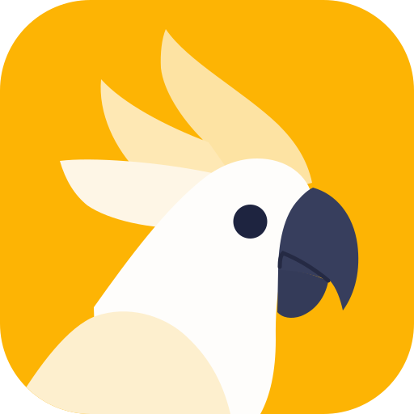
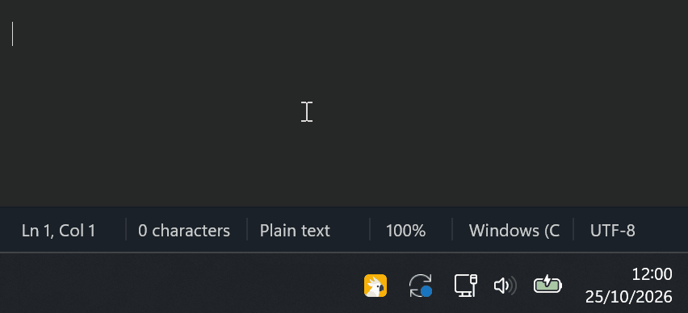

<p align="center">
  
</p>

<h1 align="center">OffSpeak</h1>

<p align="center"><b>Fast offline voice dictation that even understands your technical terms.</b></p>

<p align="center">
  <a href="https://github.com/applirado/offspeak/releases/latest"></a>
  <a href="https://github.com/applirado/offspeak/releases"></a>
  
  <a href="LICENSE"></a>
</p>

<p align="center">
  <a href="https://github.com/applirado/offspeak/releases/latest">Download</a> ·
  <a href="https://applirado.github.io/offspeak/">Website</a> ·
  <a href="https://github.com/applirado/offspeak/discussions">Discussions</a>
</p>

<p align="center">
  <b>Hold <kbd>Ctrl</kbd>+<kbd>Space</kbd> in any app, talk, let go.</b>
</p>

<p align="center">
  🎤 Spoken: <i>"Hi Tom <b>comma</b> <b>new line</b> <b>new line</b> Azure is already set up. Please don't forget to
  update the Claude MD file."</i>
</p>

<p align="center">
  
</p>

<p align="center">
  <b>comma</b> and <b>new line</b> are voice commands, the voice model sets the other punctuation by itself, and the
  vocabulary turns "Claude MD" into <i>Claude.md</i>. The middle of the recording (0:02 to 0:08) is cut out; everything
  else, from letting go to the inserted text, runs in real time.
</p>

**OffSpeak is voice dictation for Windows that runs entirely on your own machine.** Hold a hotkey, talk,
let go, and the text appears wherever your cursor is: in mail, chat, an editor or a browser. Speech
recognition, clean-up and all your settings stay on your computer. There is no account, no cloud
service and no upload.

Like the cockatoo in its logo, OffSpeak repeats what it hears, only more neatly.

---

## Highlights

- **Works in every app.** One hotkey for Outlook, Teams, Word, Slack, your browser, your code editor
  and your AI assistant. You do not have to learn a different microphone button in every program.
- **Write faster than you ever have.** Dictating with OffSpeak reaches about 120 words per minute
  from key press to inserted text (measured over 115 real dictations), two to three times the usual
  typing speed. A long email or a detailed prompt takes seconds instead of minutes.
- **Fast on an ordinary laptop CPU.** With NVIDIA Parakeet, a typical sentence is transcribed in
  0.3 to 0.5 seconds. No GPU is needed.
- **Private by design.** A built-in network guard refuses every connection that does not stay on the
  local machine. Audio, transcripts and history never leave your PC.
- **Speaks your languages.** Parakeet recognises 25 European languages, including German, English,
  French and Italian, with punctuation and capitalisation.
- **Gets your jargon right.** Common technical terms such as *Azure* come out right without any
  setup. Add your own terms like *Dataverse* or *Claude Code* to the vocabulary, and near-misses such
  as "Databurse" or "Cloud Code" are corrected automatically.
- **Voice commands.** Say "comma", "new line" or "quote" (in German "Komma", "neue Zeile",
  "Anführungszeichen") to insert punctuation and line breaks. OffSpeak tells the command "period"
  apart from the noun in "a long period".
- **Leaves your clipboard alone.** OffSpeak uses the clipboard only to paste, then puts back what you
  had copied: images, rich text and files included. It never reads the clipboard for anything else,
  and dictated text stays out of the Win+V clipboard history.
- **Optional AI clean-up.** A mode can pass the text through a local language model (any GGUF file
  via llama.cpp) to rewrite, format or translate it.

## Why not the dictation that is already built in?

Office, ChatGPT, Claude and many other apps have a microphone button of their own, and Windows has
voice typing (Win+H). For a quick message they may be all you need. OffSpeak is for when you dictate
a lot, and for text that should not leave your PC:

| | OffSpeak | Dictation in an app (Claude, ChatGPT, Office) | Windows voice typing (Win+H) | Dictation apps with a subscription |
|---|---|---|---|---|
| Where it works | in every app | only in that app | in every app | in every app |
| Where your voice goes | nowhere: recognition runs on your PC | to the provider's servers | to Microsoft's servers | mostly to the provider's servers |
| Works offline | yes | no | no | some, with a local model |
| Technical terms and names | your own vocabulary, which also fixes near-misses | varies | rarely right | usually a personal dictionary |
| English terms in German text | yes: the language is detected for you, and the vocabulary keeps your terms intact | varies | no: one language at a time | varies |
| Cost | free and open source (MIT) | part of the app | free | a monthly or yearly subscription |

That makes OffSpeak a good fit for confidential mail, customer data and workplaces where cloud speech
recognition is not allowed.

## Requirements

- Windows 10 or 11 (64-bit)
- About 1 GB of disk space for the Parakeet model

Everything else, including Python, is installed by the setup.

## Installation

Open **PowerShell** (or Terminal) and paste this line:

```powershell
powershell -c "irm https://applirado.github.io/offspeak/install.ps1 | iex"
```

It installs OffSpeak for your user account, without admin rights, into `%LOCALAPPDATA%\Programs\OffSpeak`:

1. the source code of the [latest release](https://github.com/applirado/offspeak/releases/latest)
2. [uv](https://docs.astral.sh/uv/), if it is missing, which in turn installs Python 3.12
3. OffSpeak's packages, exactly as pinned in `uv.lock`
4. the Parakeet voice model (about 1 GB), if it is not installed yet
5. a Start menu entry, an entry in **Settings > Apps**, and autostart when you sign in to Windows

Then it starts OffSpeak. Run the same line again to update. You can read
[install.ps1](install.ps1) and [setup.ps1](setup.ps1) before you run them; they are short.

To remove OffSpeak, use **Settings > Apps**. Your settings, history and models stay in
`%LOCALAPPDATA%\Offspeak`; delete that folder too if you no longer need them.

The setup is the only step that uses the internet. After that, OffSpeak works offline.

<details>
<summary>Install from a clone with setup.cmd</summary>

Clone the repository (or download it as a ZIP) and double-click **`setup.cmd`**. It does the same as
the line above, but runs OffSpeak from that folder. Run `setup.cmd` again at any time to update or
repair the installation, for example after a `git pull` or after moving the folder. Options:
`-NoAutostart`, `-NoModel` and `-NoLaunch`, for example `setup.cmd -NoAutostart`.

</details>

<details>
<summary>Manual installation with uv</summary>

```powershell
git clone https://github.com/applirado/offspeak.git
cd offspeak
uv sync
uv run offspeak download-model parakeet-tdt-0.6b-v3
uv run offspeak autostart on    # optional
```

</details>

### macOS (preview)

On a Mac with Apple Silicon, open **Terminal** and paste this line:

```bash
curl -fsSL https://raw.githubusercontent.com/applirado/offspeak/macos/install.sh | bash
```

It installs uv, Python 3.12, the packages and the Parakeet model the same way as on Windows, builds a
small **OffSpeak.app** in `~/Applications` (on your Mac, so Gatekeeper does not block it), starts it at
login and opens it. Run the same line again to update.

- **Hold Option+Space** in any app, talk, let go: the text is pasted where your cursor is. Esc cancels.
- The first time, turn on OffSpeak under **System Settings > Privacy & Security > Accessibility** (it
  needs that to see the shortcut and to paste), and allow the microphone when macOS asks.
- The cockatoo in the menu bar shows the state (yellow ready, red recording, blue transcribing, green
  done). Its menu switches modes and opens the settings folder.

The preview has no settings window and no recording pill yet, and the shortcut is fixed. The code,
settings, modes and models live in `~/Library/Application Support/Offspeak`; if something goes wrong,
`launcher.log` and `offspeak.log` there say why. To remove OffSpeak, quit it in the menu bar, drag
`~/Applications/OffSpeak.app` to the Bin, delete `~/Library/LaunchAgents/com.applirado.offspeak.plist`,
and delete the folder above if you no longer need your settings and models.

## Getting started

Start OffSpeak from the Start menu, or from the command line:

```powershell
uv run offspeak        # with a console window
uv run offspeakw       # without a console window
```

OffSpeak sits in the system tray as its cockatoo icon. The colour of the tile behind the bird shows
what it is doing:

| Colour | State |
|---|---|
| Yellow | Ready |
| Red | Recording |
| Blue | Transcribing |
| Green | Done; the text was inserted |

### Default shortcuts

| Shortcut | Action |
|---|---|
| Hold **Ctrl+Space** | Push-to-talk: records while held, inserts the text when released |
| **Ctrl+Numpad0** | Start or stop a recording |
| **Esc** | Cancel the current recording |

You can change every shortcut in the settings.

## Settings

Left-click the tray icon to open the settings. Right-click it for the menu with modes, "Copy last
result", "Transcribe file..." and "Quit".

| Tab | What you set there |
|---|---|
| **Vocabulary** | Names and technical terms to spell correctly. Terms with 6 or more letters are also fixed when they come out slightly wrong. |
| **Replacements** | Words that are always replaced, for example "my email" -> "anna@example.com". |
| **Voice commands** | How you say each punctuation command, per language (Deutsch, English, Français, Italiano). |
| **Shortcuts** | Push-to-talk, start/stop, cancel, and one shortcut per mode. |
| **Sound & display** | Optional gentle sounds when a recording starts and stops, and where the recording indicator appears: at the bottom of the screen or of the active window. |
| **Startup** | Start OffSpeak automatically when you sign in to Windows. |

At the bottom, **Test your rules** shows what your rules make of a sentence. Click **Speak** or hold
your push-to-talk shortcut, and OffSpeak puts the raw transcript into the test field instead of
pasting it. **Ctrl+Plus**, **Ctrl+Minus** and **Ctrl+mouse wheel** zoom the window.

Each tab has a **How it works** link (or press **F1**) that explains it with examples.

### Vocabulary or replacements?

For names and technical terms, the **Vocabulary** is usually all you need. Enter only the correct
spelling; OffSpeak fixes whatever sounds similar, so "Ulama" and "Olama" become "Ollama" without listing
those variants. This works for terms with 6 or more letters.

Use **Replacements** for what the vocabulary cannot fix: short words ("Jason" -> "JSON"), words that
come out very differently ("Kuber Netties" -> "Kubernetes") and text snippets ("my email" ->
"anna@example.com"). Replacements run after the vocabulary, so they always win.

### Voice commands

The commands are fixed; you choose how to say them. A few of the defaults:

| Command | English | Deutsch |
|---|---|---|
| `.` | period, full stop | Punkt |
| `,` | comma | Komma |
| `?` | question mark | Fragezeichen |
| `"..."` | quote ... unquote | Anführungszeichen (opens, then closes) |
| `( )` | open / close parenthesis | Klammer auf / Klammer zu |
| new line | new line | neue Zeile |
| new paragraph | new paragraph | neuer Absatz |
| next word as text | literally | wörtlich |

French and Italian are built in as well. "I agree, period." becomes *I agree.*, while "It was a long
period." stays as it is. To write a command word itself, say "literally" before it.

## Modes

A mode bundles a voice model, a language, an optional language model with a prompt, and its own
shortcut. Modes are JSON files in `%LOCALAPPDATA%\Offspeak\modes\`:

```json
{
  "key": "mail",
  "name": "E-Mail",
  "voice_model": "parakeet-tdt-0.6b-v3",
  "language": "en",
  "language_model": "Qwen3-4B-Instruct-Q4_K_M",
  "prompt": "Turn the dictation into a short, friendly e-mail.",
  "context_from_selection": true,
  "activation_apps": ["outlook"],
  "shortcut": "Control+Numpad2"
}
```

- `language_model` is the file name of a `.gguf` file in the models folder, without the extension.
  Leave it empty for plain dictation, which is the fastest and most faithful option.
- `activation_apps` switches to the mode automatically when one of these programs is in front.
- The selected text can be passed to the language model as context, so you can select a paragraph
  and say things like "make this more formal". It is read only in modes with a language model and
  never stored.

After editing a mode, choose **Reload settings** in the tray menu.

## Models

Models live in `%LOCALAPPDATA%\Offspeak\models\`.

| Model | Type | Notes |
|---|---|---|
| `parakeet-tdt-0.6b-v3` | Voice (ONNX) | **Recommended.** Fast and accurate, 25 languages. |
| `small`, `large-v3-turbo`, ... | Voice (whisper.cpp) | Supports translation to English; noticeably slower on a CPU. |
| any `*.gguf` | Language model (llama.cpp) | Optional; used only in modes that set `language_model`. |

```powershell
uv run offspeak models                    # list installed models
uv run offspeak download-model small      # download a whisper.cpp model
```

## Command line

```powershell
uv run offspeak transcribe recording.wav    # transcribe a file (wav, flac, mp3, ogg)
uv run offspeak listen                      # record until Enter, then print the text and the timing
uv run offspeak history "Dataverse"         # search past dictations
uv run offspeak import-superwhisper         # take over modes, vocabulary and shortcuts from Superwhisper
uv run offspeak autostart on                # start at sign-in (on / off; no argument shows the state)
```

## Where your data lives

Everything is stored under `%LOCALAPPDATA%\Offspeak` (or the folder in `OFFSPEAK_HOME`):

- `settings.json` and `modes\`: your configuration
- `history.sqlite`: past dictations, searchable
- `recordings\`: the audio of each dictation; audio older than 30 days is deleted automatically
- `models\`: voice and language models

## Development

```powershell
uv run pytest
```

The code is in `src/offspeak/`. The text pipeline is rule-based and has no UI dependencies:
`commands.py` handles voice commands, `textproc.py` handles vocabulary and replacements, and
`pipeline.py` ties speech recognition and post-processing together.

The landing page is the single file `website/index.html`; it has no build step and loads nothing from
other servers.

## Thanks

OffSpeak's speed comes from **NVIDIA Parakeet TDT 0.6B v3**. It transcribes a typical sentence in a
third of a second on an ordinary laptop CPU, sets punctuation by itself and understands 25 European
languages. Switching from whisper.cpp to Parakeet made dictation more than twice as fast end to end.
Thank you to the NVIDIA NeMo team for releasing it openly
([model card](https://huggingface.co/nvidia/parakeet-tdt-0.6b-v3), CC BY 4.0).

OffSpeak also builds on [onnx-asr](https://github.com/istupakov/onnx-asr), which runs Parakeet with
[ONNX Runtime](https://onnxruntime.ai), on [whisper.cpp](https://github.com/ggml-org/whisper.cpp) and
on [llama.cpp](https://github.com/ggml-org/llama.cpp).

## License

OffSpeak is released under the [MIT License](LICENSE). The voice models are not part of this
repository; they are downloaded during setup under their own licenses (NVIDIA Parakeet: CC BY 4.0,
whisper.cpp models: MIT).

Made by Applirado.

---

```
         ..............................................
     ......................................................
   ..........................................................
  .......................%%%..................................
 ........................%%%%%.................................
.........................%%%%%%%%...............................
..........................%%%%%%%%%.............................
................%%%.......%%%%%%%%%%%%..........................
................%%%%%%.....%%%%%%%%%%%%%........................
.................%%%%%%%%....%%%%%%%%%%%%%%.....................
.................%%%%%%%%%%%%%%%%%%%%%%%%%%%%...................
..................%%%%%%%%%%%%%%%%%%%%%%%%%%%%..................
..........@@@@@@@@@@%%%%%%%%%%%%%%%%%@@@@@@%%%%.................
..........@@@@@@@@@@@@@@@@@@@@@@@@@@@@@@@@@@@@%%................
...........@@@@@@@@@@@@@@@@@@@@@@@@@@@@@@@@@@@@@................
.............@@@@@@@@@@@@@@@@@@@@@@@@@@@@@@@@@######............
................@@@@@@@@@@@@@@@@@@@@#####@@@@########...........
.......................@@@@@@@@@@@@@#####@@@###########.........
......................@@@@@@@@@@@@@@@@#@@@@############.........
.....................@@@@@@@@@@@@@@@@@@@@@@############.........
...................@@@@@@@@@@@@@@@@@@@@@@@@############.........
..................@@@@@@@@@@@@@@@@@@@@@@@@@############.........
................@@@@@@@@@@@@@@@@@@@@@@@@@@@#######..###.........
...............@@@@@@@@@@@@@@@@@@@@@@@@@@@@######....#..........
..............++++++++++@@@@@@@@@@@@@@@@@@@.##..................
...........+++++++++++++++++@@@@@@@@@@@@@@@.....................
.........+++++++++++++++++++++@@@@@@@@@@@@@.....................
 .......+++++++++++++++++++++++@@@@@@@@@@@.....................
  ....+++++++++++++++++++++++++++@@@@@@@@@....................
   ..+++++++++++++++++++++++++++++@@@@@@@@...................
     ++++++++++++++++++++++++++++++@@@@@@..................
         ++++++++++++++++++++++++++@@@@@@..............

           ___   __  __   ____                   _
          / _ \ / _|/ _| / ___| _ __   ___  __ _| | __
         | | | | |_| |_  \___ \| '_ \ / _ \/ _` | |/ /
         | |_| |  _|  _|  ___) | |_) |  __/ (_| |   <
          \___/|_| |_|   |____/| .__/ \___|\__,_|_|\_\
                               |_|

                    Dictate Fast, Stay Local
```
